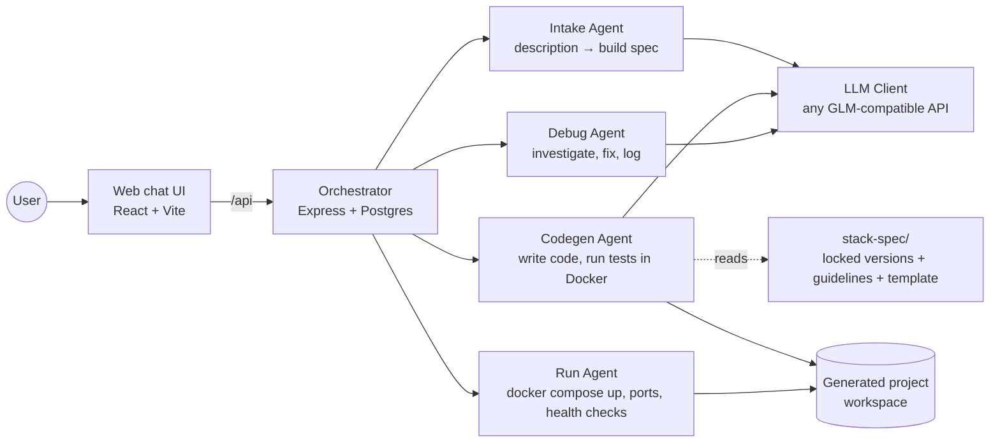

# Virtual App Builder

**Describe an app in plain English. Get a working, tested Rails + React Native codebase running in Docker.**

Virtual App Builder is an open-source, LLM-powered AI app generator. You chat with it in a web UI, it turns your idea into a build plan, then a coding agent writes the code, runs the test suite inside Docker, and keeps fixing until the tests actually pass. Then it starts the app and hands you live URLs.

It is built around an *opinionated, locked tech stack* so the generated code is consistent, conventional, and reviewable, rather than a different framework every time.

> **Status: early-stage / experimental.** The backend pipeline is proven end to end. Frontend generation is still being verified, and there are no user accounts, git/zip delivery, or durable job queue yet. See [What works today](#what-works-today) and [Roadmap](#roadmap) for the honest picture.

---

## How it works

```text
/build a task tracker where each task has a title and a due date
```

1. **Intake Agent** turns your description into a structured build spec (or asks one clarifying question if it's too vague).
2. You review the proposed plan and reply `/proceed`.
3. **Codegen Agent** writes real code in your project's workspace, runs `bundle exec rspec` in Docker, reads the failures, and iterates. The model's own "I'm done" is never trusted: a final test run is what certifies success.
4. **Run Agent** brings the app up with `docker compose`, allocates ports, runs migrations, health-checks every URL, and replies with the live links.
5. Something broken? **Debug Agent** (`/debug <what's wrong>`) investigates, fixes, re-verifies, and logs the bug in your generated project's own backlog.

Every project you create also gets its own copy of a lightweight governance loop (backlog, blueprints, design docs, changelog), so what the agents build leaves a real paper trail.

### Chat commands

| Command | What it does |
|---|---|
| `/build <description>` | Plan a new app, or an incremental change to an existing one. Asks a clarifying question if the description is ambiguous. |
| `/proceed` | Approve the proposed plan and start generating code. |
| `/run` | Start the generated app (or report its live URLs if it's already running). |
| `/stop` | Stop the app's containers. Code and data are untouched. |
| `/debug [description]` | Investigate and fix a reported problem, or run a general health check if no description is given. |

Anything else you type is ordinary chat with the configured model.

---

## What works today

- **Backend generation, proven**: multi-resource CRUD with `belongs_to` / `has_many` / `has_one` associations in a Rails API, verified against real `rspec` runs (e.g. a 3-resource app reaching 36 passing examples).
- **Incremental builds**: `/build` against an already-built project describes a *delta* ("add a reminders screen") and avoids rewriting what exists. A read-only planning pass decides which side (backend / frontend) actually needs work, so unneeded phases are skipped.
- **Resumable**: every build, passing, failing, or interrupted, writes an honest record (design doc, backlog row, changelog entry), and a follow-up `/build continue` picks up what's left.
- **Live preview**: generated apps are started with Docker Compose, with every component's URL injected into the others, so cross-component wiring and CORS work regardless of which ports are allocated.
- **Debug loop**: `/debug` finds root causes, fixes them, and re-verifies both sides' full test suites.
- **Web chat UI**: per-project chat history (persisted in Postgres), stage tracking, live progress polling, live token-usage footer, printable transcripts.
- **Bring your own model**: works with any GLM-API-compatible (OpenAI-style chat completions with tool calling) endpoint, configured purely through environment variables.

**Experimental / not yet built:** Expo / React Native frontend generation (implemented, live verification in progress), auth, MongoDB, Sidekiq, many-to-many associations, SSE/WebSocket streaming, accounts, git push / zip delivery, cloud IaC. Full detail in [`docs/blueprints/features.md`](docs/blueprints/features.md).

---

## The stack it generates

Every generated app uses the same locked stack, defined in [`stack-spec/versions.yaml`](stack-spec/versions.yaml) with decision guidelines in [`stack-spec/guidelines/`](stack-spec/guidelines/):

| Layer | Technology |
|---|---|
| Backend | Ruby 3.3, Rails 7.1 (API-only), RSpec + FactoryBot, Blueprinter |
| Data (planned) | MySQL 8, MongoDB 7 (Mongoid), Redis 7 + Sidekiq |
| Auth (planned) | Devise + devise-jwt |
| Frontend | TypeScript, React Native via Expo, React Navigation, Zustand, React Native Paper, Jest + RNTL |
| Infra | Docker, docker-compose (cloud IaC deferred) |

The builder itself is TypeScript on Node.js 20+.

---

## Quickstart

### Prerequisites

- **Node.js 20+**
- **Docker** with Docker Compose (used for the orchestrator's Postgres *and* for running generated code)
- An API key for a **GLM-compatible LLM endpoint** that supports tool calling (defaults to Zhipu's hosted GLM API; self-hosted endpoints work too)

### 1. Install and build

```bash
git clone https://github.com/theprogrammerin/product-builder.git
cd product-builder
npm install
npm run build
```

### 2. Configure

```bash
cp packages/orchestrator/.env.example packages/orchestrator/.env
```

Edit `packages/orchestrator/.env` and set at least `GLM_API_KEY`:

| Variable | Required | Default | Notes |
|---|---|---|---|
| `GLM_BASE_URL` | yes | `https://open.bigmodel.cn/api/paas/v4` | Any GLM-compatible endpoint |
| `GLM_API_KEY` | yes | none | Sent as a Bearer token |
| `GLM_MODEL` | yes | `glm-4.6` | Must support tool calling |
| `GLM_TIMEOUT_MS` | no | `60000` | Per-request timeout; consider raising it for large builds |
| `GLM_MAX_RETRIES` | no | `2` | Retries on timeout / 429 / 5xx |
| `PORT` | no | `4000` | Orchestrator port |
| `PROJECT_FILES_DIR` | no | `./generated-projects` | Where each project's codebase is written |
| `DATABASE_URL` | no | local compose Postgres | Projects and chat history |

### 3. Start everything

In three terminals:

```bash
# Postgres for the orchestrator
cd packages/orchestrator && docker compose up -d
```

```bash
# API server (http://localhost:4000)
npm run dev --workspace @app-builder/orchestrator
```

```bash
# Web UI (Vite dev server; proxies /api to the orchestrator)
npm run dev --workspace @app-builder/web
```

Open the URL Vite prints, create a project, and try:

```text
/build a task tracker where each task has a title, a due date, and a done flag
```

Review the plan, reply `/proceed`, and watch the agents work. Generated code lands in `packages/orchestrator/generated-projects/<project-id>/`.

### Use the agents from the command line

The Intake and Codegen agents also work standalone, with no web UI or database needed:

```bash
npx intake-agent --description "a List that has many Items" --out spec.md
npx codegen-agent --workspace <path-to-scaffolded-project> --spec spec.md
```

---

## Architecture



This is an npm-workspaces monorepo:

| Package | Role |
|---|---|
| [`packages/web`](packages/web) | Single-page chat UI |
| [`packages/orchestrator`](packages/orchestrator) | API, project registry, chat history, scaffolding, command routing |
| [`packages/intake-agent`](packages/intake-agent) | Free text → markdown build spec (or one clarifying question) |
| [`packages/codegen-agent`](packages/codegen-agent) | LLM tool-calling loop that writes and runs code until tests pass |
| [`packages/run-agent`](packages/run-agent) | Starts/stops generated apps with Docker Compose, allocates ports, health-checks |
| [`packages/debug-agent`](packages/debug-agent) | Investigates and fixes issues in already-built projects |
| [`packages/llm-client`](packages/llm-client) | Provider-agnostic `LLMClient` with a GLM implementation |
| [`stack-spec/`](stack-spec) | The locked stack: versions, guidelines, and the starter template copied into every new project |

More detail: [`docs/blueprints/architecture.md`](docs/blueprints/architecture.md) and the per-component docs in [`docs/blueprints/components/`](docs/blueprints/components/).

---

## Development

```bash
npm run build   # compile every package
npm test        # run every package's unit tests (LLM and Docker calls are mocked)
```

This project follows its own mandatory feature and bug workflow (backlog → prioritize → blueprint impact → design doc → build), described in [`CLAUDE.md`](CLAUDE.md). Every shipped feature has a permanent design record in [`docs/designs/`](docs/designs/), and what shipped when is in [`CHANGELOG.md`](CHANGELOG.md).

## Roadmap

The living roadmap and feature queue are in [`docs/backlog.md`](docs/backlog.md). Headline items still ahead: finishing frontend generation, auth / MongoDB / Sidekiq in generated apps, real streaming, accounts, a durable job queue, and git push / zip delivery.

## Contributing

Issues and pull requests are welcome. Please read [`CLAUDE.md`](CLAUDE.md) first. Larger changes start as a backlog entry and an agreed design doc rather than a surprise PR.

## Limitations worth knowing

- Generated code quality depends on the LLM you point it at; the test-driven loop catches a lot, but review what you ship.
- `/build` runs as an in-process job: restarting the orchestrator mid-build loses that run's result.
- Docker is required, and builds can take a while and consume many LLM tokens. The footer shows live token usage.
- Only GLM-API-compatible endpoints are supported today; other providers need a new `LLMClient` implementation.

## License

No license file has been added yet. Until one is, all rights are reserved by default. See the repository for updates.

---

<sub>Keywords: AI app builder, AI code generator, LLM agents, text-to-app, natural language to app, AI coding agent, Rails generator, React Native generator, Expo, Docker, autonomous coding agent, GLM, full-stack app generator, no-code, low-code.</sub>
