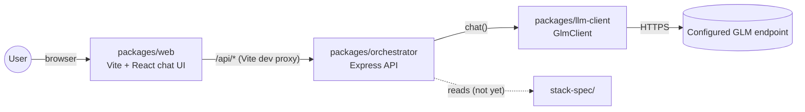
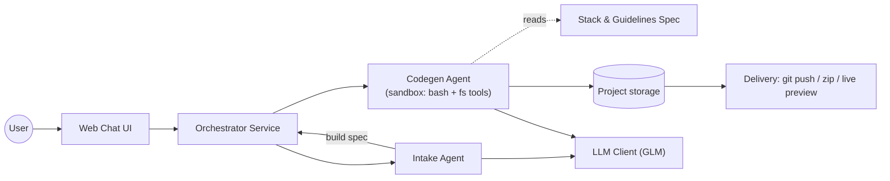

# Architecture Blueprint

High-level shape of the system: what's actually running today, and the
target architecture it's being built toward. Per-component detail lives
under [`components/`](./components/); current capabilities are inventoried
in [`features.md`](./features.md).

## Current implementation (Phase 0 / 0.5)

- **[`packages/web`](../../packages/web)** — single-page chat UI: project
  selector, "new project" form, stage selector, message thread. Talks only
  to the orchestrator's `/api/*` routes. → [blueprint](./components/web.md)
- **[`packages/orchestrator`](../../packages/orchestrator)** — Express
  service holding the project registry and chat, both in-memory today.
  This is the seam where the future Intake/Codegen agents attach.
  → [blueprint](./components/orchestrator.md)
- **[`packages/llm-client`](../../packages/llm-client)** —
  provider-agnostic `LLMClient` interface with one implementation,
  `GlmClient`, for any GLM-API-compatible endpoint.
  → [blueprint](./components/llm-client.md)
- **[`stack-spec/`](../../stack-spec)** — data, not code: locked versions
  and guidelines the future Codegen Agent must follow.
  → [blueprint](./components/stack-spec.md)

Nothing here generates an app yet — chat is a direct passthrough to GLM
with a static system prompt.

## Target architecture

Six components, long term:

1. **Stack & Guidelines Spec** — the opinionated brain (already built).
2. **Intake Agent** — turns a free-text product description into a
   structured build spec (entities, roles, workflows, screens).
3. **Codegen Agent** — sandboxed, agentic coding loop that writes and
   *runs* code against the spec until it builds and passes tests.
4. **LLM Client** — already built; both agents above go through it.
5. **Orchestrator Service** — grows from today's passthrough into the
   thing that runs Intake → Codegen, streams progress, persists projects,
   and delivers the result.
6. **Web Chat UI** — grows from today's chat into progress view + file
   tree + delivery step.

Locked stack for *generated* apps (not this builder tool itself): Rails +
MySQL + MongoDB + Redis/Sidekiq backend, Expo/React Native + Zustand +
React Native Paper frontend, Docker/docker-compose for local infra (cloud
IaC deliberately deferred). Full detail: [`stack-spec` blueprint](./components/stack-spec.md).

For what's next and in what order, see [`docs/backlog.md`](../backlog.md).
For what shipped when, see [`CHANGELOG.md`](../../CHANGELOG.md).
