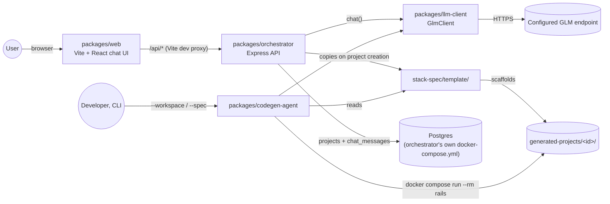
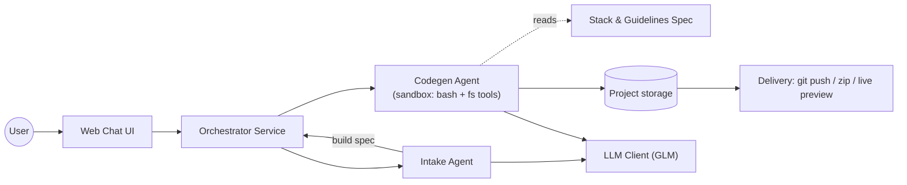

# Architecture Blueprint

High-level shape of the system: what's actually running today, and the
target architecture it's being built toward. Per-component detail lives
under [`components/`](./components/); current capabilities are inventoried
in [`features.md`](./features.md).

## Current implementation (Phase 0 / 0.5 / 0.75 / 1-in-part)

- **[`packages/web`](../../packages/web)** — single-page chat UI: project
  selector, "new project" form, stage selector, message thread. Talks only
  to the orchestrator's `/api/*` routes. → [blueprint](./components/web.md)
- **[`packages/orchestrator`](../../packages/orchestrator)** — Express
  service holding the project registry and chat history in Postgres,
  plus on-disk scaffolding of each new project from `stack-spec/template/`.
  This is the seam where the Intake Agent and a wired-in Codegen Agent
  will attach. → [blueprint](./components/orchestrator.md)
- **[`packages/llm-client`](../../packages/llm-client)** —
  provider-agnostic `LLMClient` interface with one implementation,
  `GlmClient`, for any GLM-API-compatible endpoint.
  → [blueprint](./components/llm-client.md)
- **[`packages/codegen-agent`](../../packages/codegen-agent)** — CLI-only
  for now, not yet wired into the orchestrator. Given a scaffolded
  project and a hand-written build spec, runs an LLM tool-calling loop
  that writes and runs real backend code inside Docker until
  `bundle exec rspec` passes. Proven on one CRUD resource.
  → [blueprint](./components/codegen-agent.md)
- **[`stack-spec/`](../../stack-spec)** — `guidelines/` are now consumed
  programmatically (the Codegen Agent's system prompt); `template/`
  provides a real `rails new` backend skeleton plus a still-bare frontend
  skeleton, copied into every new project. → [blueprint](./components/stack-spec.md)

Chat is still a direct GLM passthrough — the Codegen Agent isn't wired
into it yet, so a chat message doesn't generate anything. What *is* real:
every project gets a real, working starting codebase on disk; both the
project registry and chat history persist in Postgres (the orchestrator's
own — separate from the locked MySQL/MongoDB stack for *generated*
apps); and a developer can run the Codegen Agent CLI by hand against a
project's `workspacePath` to generate a working resource.

## Target architecture

Six components, long term:

1. **Stack & Guidelines Spec** — the opinionated brain (already built).
2. **Intake Agent** — turns a free-text product description into a
   structured build spec (entities, roles, workflows, screens).
3. **Codegen Agent** — sandboxed, agentic coding loop that writes and
   *runs* code against the spec until it builds and passes tests. First
   slice proven (one CRUD resource, backend only); auth/Mongo/Sidekiq/
   frontend/multi-resource still ahead.
4. **LLM Client** — already built; both agents above go through it.
5. **Orchestrator Service** — grows from today's passthrough into the
   thing that runs Intake → Codegen, streams progress, persists projects,
   and delivers the result.
6. **Web Chat UI** — grows from today's chat into progress view + file
   tree + delivery step.

Locked stack for *generated* apps (not this builder tool itself): Rails +
MySQL + MongoDB + Redis/Sidekiq backend, Expo/React Native + Zustand +
React Native Paper frontend, Docker/docker-compose for local infra (cloud
IaC deliberately deferred). Full detail: [`stack-spec` blueprint](./components/stack-spec.md).

For what's next and in what order, see [`docs/backlog.md`](../backlog.md).
For what shipped when, see [`CHANGELOG.md`](../../CHANGELOG.md).
