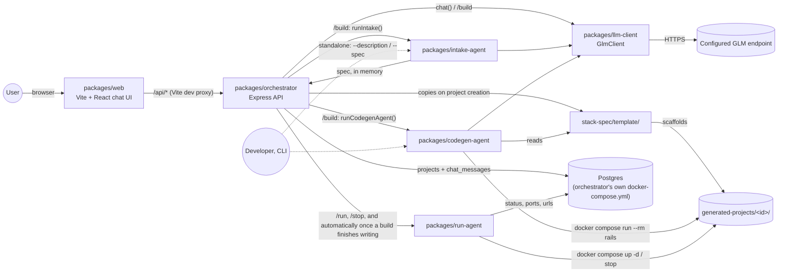
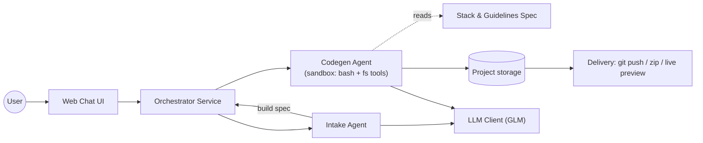

# Architecture Blueprint

High-level shape of the system: what's actually running today, and the
target architecture it's being built toward. Per-component detail lives
under [`components/`](./components/); current capabilities are inventoried
in [`features.md`](./features.md).

## Current implementation (Phase 0 / 0.5 / 0.75 / 1 / 2 / 3-milestone-1)

- **[`packages/web`](../../packages/web)** — single-page chat UI: project
  selector, "new project" form, stage selector, message thread, and
  polling for `/build` progress while one is in flight. Talks only to the
  orchestrator's `/api/*` routes. → [blueprint](./components/web.md)
- **[`packages/orchestrator`](../../packages/orchestrator)** — Express
  service holding the project registry and chat history in Postgres,
  on-disk scaffolding of each new project from `stack-spec/template/`,
  and — new — a `/build <description>` chat message that runs the Intake
  and Codegen Agents in-process against a project's workspace.
  → [blueprint](./components/orchestrator.md)
- **[`packages/llm-client`](../../packages/llm-client)** —
  provider-agnostic `LLMClient` interface with one implementation,
  `GlmClient`, for any GLM-API-compatible endpoint.
  → [blueprint](./components/llm-client.md)
- **[`packages/codegen-agent`](../../packages/codegen-agent)** — usable
  standalone (CLI) or as a library (the orchestrator's first real
  consumer). Given a scaffolded project and a build spec (hand-written,
  or produced by the Intake Agent), runs an LLM tool-calling loop that
  writes and runs real backend code inside Docker until `bundle exec
  rspec` passes. Proven on multi-resource CRUD + associations.
  → [blueprint](./components/codegen-agent.md)
- **[`packages/intake-agent`](../../packages/intake-agent)** — usable
  standalone (CLI, chained by hand into the Codegen Agent) or as a
  library. Turns a free-text product description into the same markdown
  build-spec the Codegen Agent reads, or a single clarifying question if
  the description doesn't have enough in it.
  → [blueprint](./components/intake-agent.md)
- **[`packages/run-agent`](../../packages/run-agent)** — given a
  project's own `docker-compose.yml`, discovers which services should be
  exposed (a one-to-many `project → components` mapping, not a fixed
  backend/frontend pair), allocates each a free host port, migrates the
  database, brings the stack up, and health-checks every URL. Triggered
  automatically once a build finishes writing its app (concurrently with
  final verification, not after it) and by `/run`/`/stop`.
  → [blueprint](./components/run-agent.md)
- **[`stack-spec/`](../../stack-spec)** — `guidelines/` are now consumed
  programmatically (the Codegen Agent's system prompt); `template/`
  provides a real `rails new` backend skeleton plus a still-bare frontend
  skeleton, copied into every new project. → [blueprint](./components/stack-spec.md)

Ordinary chat is still a direct GLM passthrough. What's new: a `/build
<description>` message in that same chat actually generates and verifies
real backend code — Intake then Codegen, in-process, against the
project's own scaffolded workspace — with progress posted back into chat
and polled by the web UI. Still no accounts, real streaming (SSE/
WebSocket), delivery, or durable job queue — `/build` is a fire-and-forget
in-process promise, guarded against concurrent runs on the same project
but not against an orchestrator restart. The Intake/Codegen Agent CLIs
remain independently usable by a developer, unchanged.

## Target architecture

Six components, long term:

1. **Stack & Guidelines Spec** — the opinionated brain (already built).
2. **Intake Agent** — turns a free-text product description into a build
   spec. First slice proven (one resource, markdown brief, one clarifying
   question if needed); the original richer spec (entities, roles,
   workflows, screens, multi-resource) is still ahead.
3. **Codegen Agent** — sandboxed, agentic coding loop that writes and
   *runs* code against the spec until it builds and passes tests. First
   slice proven (one CRUD resource, backend only); auth/Mongo/Sidekiq/
   frontend/multi-resource still ahead.
4. **LLM Client** — already built; both agents above go through it.
5. **Orchestrator Service** — `/build` proves the core Intake → Codegen
   wiring works end-to-end; still needs accounts, real streaming (today's
   progress is polled, not pushed), durable job persistence across a
   restart, and delivery (git push/zip).
6. **Web Chat UI** — `/build` progress currently renders as more chat
   messages, polled while a build is in flight; still needs a proper
   progress view, file tree, and delivery step.

Not one of the original six, but built ahead of the original Phase 4
plan: the **Run Agent** (`packages/run-agent`) delivers the "live
preview" half of Phase 4 early — a docker-compose-based live URL, not a
git-push/zip delivery. Follow-up iteration against an already-built
project is still ahead.

Locked stack for *generated* apps (not this builder tool itself): Rails +
MySQL + MongoDB + Redis/Sidekiq backend, Expo/React Native + Zustand +
React Native Paper frontend, Docker/docker-compose for local infra (cloud
IaC deliberately deferred). Full detail: [`stack-spec` blueprint](./components/stack-spec.md).

For what's next and in what order, see [`docs/backlog.md`](../backlog.md).
For what shipped when, see [`CHANGELOG.md`](../../CHANGELOG.md).
