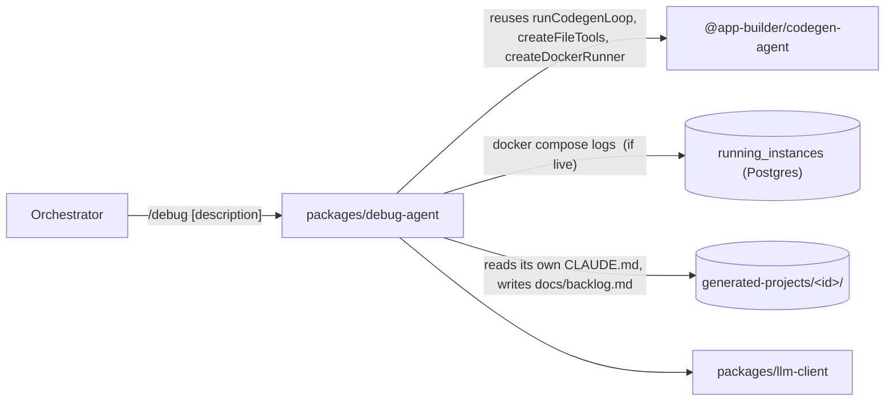

# Design: Debug Agent

- **Backlog item**: [`docs/backlog.md`](../backlog.md) — # 11
- **Status**: implemented — verified live against a real, previously-built
  generated project 2026-09-03 (see Verification status below)

## Verification status

Built as designed below: `packages/debug-agent` (two-pass backend/frontend
run reusing `runCodegenLoop`/`createFileTools`/`createDockerRunner` from
`@app-builder/codegen-agent` unchanged, plus the small additive
`toolDefinitions?`/override to that package's `RunOptions` this required
— see "A design refinement found during implementation" below), wired
into the orchestrator's `/debug` command, bug #8 fixed in
`stack-spec/template/`. 141 tests pass across the whole workspace
(toolDefinitions, initial-context assembly with mocked Docker/logs, the
full two-pass flow with injected fakes, and the orchestrator's `/debug`
wiring — ack, interim narration, `[debug:done]`/`[debug:failed]`, the
live-components pass-through from `runStore`, and all three concurrency
guards).

### Live end-to-end run (2026-09-03)

The originally configured GLM endpoint (`api.sarvam.ai`, model
`glm5.3-flash`) stayed on `503 model_overloaded` / `no_available_workers`
after two attempts (confirmed via a raw `curl` — a provider-side capacity
issue, not our retry logic or a timeout). Switched to a newly-configured
endpoint (OpenRouter, `cohere/north-mini-code:free`) — confirmed
tool-calling support with a direct `curl` first, then updated all four
`.env` files (`orchestrator`, `codegen-agent`, `intake-agent`, plus the
already-updated `llm-client`) to match, commenting out rather than
deleting the old config.

Real test: introduced a genuine backend bug into the already-built,
previously-passing generated project (`31f07053-1988-483a-953d-4676cefc3387`)
— dropped `:done` from `TasksController#task_params`'s `permit`, which
broke 2 of its 21 rspec examples (create-with-done, toggle-done) exactly
as expected. Ran the real, compiled `runDebugAgent` (not mocked) with the
description *"Toggling a task's done status from the app doesn't
actually save — it always comes back false."* Result:

- Correctly diagnosed the root cause after reading the model, migration,
  controller, blueprint, and request spec — never guessed.
- Fixed `task_params` back to `permit(:title, :done)`.
- Read the project's own `CLAUDE.md`, then wrote two well-formed rows
  into the project's own `docs/backlog.md` Bugs table, both status
  `fixed`, design-doc column correctly left blank (small, self-contained
  fix) — exactly the workflow this repo holds itself to, now followed by
  the Debug Agent on the project it's investigating.
- Re-verified for real: backend went from 19/21 to **21 examples, 0
  failures**.
- Total footprint: exactly two files touched
  (`tasks_controller.rb` + `docs/backlog.md`) — no new design doc (correct,
  since none was needed), no unrelated changes.
- Frontend pass correctly recognized the reported issue wasn't on its
  side and made no changes there — it didn't try to "fix" the project's
  pre-existing, unrelated frontend gap (see below).
- Overall `fixed: false` — **by design, and correctly so**: the frontend
  suite has a pre-existing, unrelated failure (an `AggregateError` inside
  `TaskListScreen.test.tsx`'s `render()`, 6/24 tests) that predates this
  session's work entirely (this project's frontend was never at a full
  clean pass — see frontend-generation.md's own Verification status).
  `runDebugAgent`'s `fixed` flag requires *both* sides to pass, on
  purpose, so it correctly refused to claim overall success while an
  unrelated gap remains — it does not mean the reported bug wasn't fixed.
- One real, minor rough edge: the backend pass never converged cleanly
  (kept exploring well past the point the fix was verified working,
  eventually hitting its 25-iteration cap) — wasteful, but harmless,
  since `runDebugAgent` doesn't depend on `converged: true` from either
  pass, only its own final re-verification. Worth a smaller-model-specific
  prompt tightening later, not a correctness bug.
- One cosmetic issue: the logged bug rows used "1" for Priority instead
  of descriptive text like this repo's own convention (e.g. "now, small
  fix") — harmless, well-formed markdown either way.

Feature #11 is `done`.

### A design refinement found during implementation

The design above didn't anticipate a real sandboxing conflict: the Debug
Agent needs to read/write `CLAUDE.md` and `docs/backlog.md` at the
project root, but `createFileTools` rooted at `backend/` or `frontend/`
(as originally sketched, mirroring the Codegen Agent) would hard-reject
`../CLAUDE.md` as escaping its sandbox — `resolveScoped` exists
specifically to block exactly that. Fixed by rooting `fileTools` at the
whole `workspacePath` instead, which in turn meant codegen-agent's stock
`TOOL_DEFINITIONS` (whose descriptions say "relative to the project's
backend/ root") would be actively wrong for the Debug Agent. Rather than
work around that with prompt-level contradiction of the tool metadata,
added an optional `toolDefinitions?: ToolDefinition[]` to
`runCodegenLoop`'s `RunOptions` (defaulting to the existing
`TOOL_DEFINITIONS`, so every existing caller is unaffected) and gave
`debug-agent` its own accurately-worded tool definitions
(`toolDefinitions.ts`). `executeTool()`'s dispatch — and therefore
`@app-builder/codegen-agent`'s own behavior — didn't need to change at
all, since it only cares about tool *names*, not descriptions.

## Summary

`/debug [description]` investigates an already-built generated project —
a user-reported problem, or (with no description) a general health sweep
— finds the root cause(s), fixes them, re-verifies for real, and logs
every issue it looked into into *that project's own* `docs/backlog.md`
Bugs table, following that project's own copy of the mandatory Bug
workflow. Reuses the Codegen Agent's tool-calling loop rather than
duplicating it: same mechanics, a different job (patch an existing
codebase narrowly, not build fresh).

## Feature-set impact

- New chat command: **`/debug [description]`**.
  - With a description: investigates that specific report.
  - With no description: runs a general sweep — current test status on
    both sides, plus (if the project is currently running via the Run
    Agent) each live component's recent logs — looking for anything
    wrong, not just what was described.
- Scope is broad by design: functional bugs, failing tests, runtime
  crashes on a live instance — never narrowed to only what the user
  happened to mention.
- For every issue it looks into (found or reported), it writes a row into
  **that project's own `docs/backlog.md` "Bugs" table** — the governance
  copy already scaffolded into every generated project (feature #1) —
  following that project's own `CLAUDE.md`'s Bug workflow: `reported` →
  `prioritized` → root-cause → design-doc-or-skip → `fixed`. A small,
  self-contained fix skips the design doc (same as this repo's own bugs
  #1–#7 did); anything touching multiple files/behaviors gets one, copied
  from that project's own `docs/designs/TEMPLATE.md`.
- Re-verifies for real before declaring success — both `bundle exec
  rspec` and `npx jest` must still pass (not just the side it touched),
  same "never trust the model's own done claim" discipline as `/proceed`.
- Replies `[debug:done] <summary>` or `[debug:failed] <reason>`; interim
  narration is `[debug] <text>`, same tagging convention as `/build`.
- Guarded the same way `/build`/`/proceed` are — one code-mutating
  operation per project at a time (shares the existing `buildingProjects`
  guard, so `/debug` and `/proceed` can't run concurrently either).
- If the project is live (via the Run Agent) while `/debug` runs, edits
  are visible immediately through the same bind mounts Codegen Agent
  already relies on (Rails class-reloads, Expo hot-reloads) — the live
  preview may show an intermediate, broken state mid-fix. Not gated on
  stopping the instance first; this is a known characteristic, not
  something this feature tries to prevent.

## Architecture impact



- **New component, `packages/debug-agent`** — does *not* duplicate the
  tool-calling loop: imports `runCodegenLoop`, `createFileTools`,
  `createDockerRunner` from `@app-builder/codegen-agent` directly (with
  its own, differently-worded tool definitions — see below), supplying
  its own system prompt and running two scoped passes
  (backend, then frontend — mirroring the Codegen Agent's own structure)
  rather than inventing a new multi-service tool surface. Each pass sees
  the same shared diagnostic context (both sides' current test results,
  live logs if any) so even a backend-scoped pass can correctly conclude
  "this is a frontend issue, nothing to change here."
- Its system prompt tells it to **read the project's own `CLAUDE.md`
  first** to learn the Bug workflow, rather than hardcoding those rules
  into the agent — mirrors how the Codegen Agent already reads
  `stack-spec/guidelines/*.md` instead of hardcoding stack rules.
- Log-fetching for a live instance reuses `runDockerCompose` from
  `@app-builder/run-agent` (`docker compose logs --tail=200 <service>`) —
  a one-shot snapshot fed into the initial context, not a new interactive
  tool the model can call mid-loop. Keeps the existing `TOOL_DEFINITIONS`
  untouched (their descriptions already say "the project's backend/ (or
  frontend/) root," which stays accurate under the two-pass design).
- **Orchestrator**: new `/debug` handler, structurally identical to
  `/proceed`'s (`RunDebugPhase` injectable, `[debug]`/`[debug:done]`/
  `[debug:failed]` tags, fire-and-forget promise, guarded by the existing
  `buildingProjects` set). Pulls the project's live `RunInstance` from
  `runStore` (if any) to pass component names into the Debug Agent for
  log-fetching — orchestrator itself never talks to Docker directly, same
  separation already established for the other two agents.
- **Hard prerequisite**: [bug #8](../backlog.md) —
  `stack-spec/template/CLAUDE.md`/`docs/backlog.md` never received the
  Bug workflow section/Bugs table this repo added to itself, so no
  generated project currently has anything for the Debug Agent to follow.
  Fixed as part of this feature's build, same pattern as bug #5 folding
  into the Run Agent.

## Components affected

- `packages/debug-agent` (new) — system prompt, initial-context assembly
  (test results + live logs), the two-pass backend/frontend run, final
  combined verification.
- [`packages/orchestrator`](../../packages/orchestrator) — `app.ts`
  (`/debug` handler, `RunDebugPhase` type), reusing `runStore`/`chatStore`/
  `buildingProjects` unchanged. See
  [component blueprint](../blueprints/components/orchestrator.md).
- [`stack-spec/template/CLAUDE.md`](../../stack-spec/template/CLAUDE.md) /
  [`stack-spec/template/docs/backlog.md`](../../stack-spec/template/docs/backlog.md) —
  add the missing Bug workflow section / Bugs table (bug #8).
- [`packages/web`](../../packages/web) — render `[debug]`/`[debug:done]`/
  `[debug:failed]` (same polling mechanism, extended terminal-tag regex).
- [`packages/codegen-agent`](../../packages/codegen-agent) — one small,
  additive change found during implementation: `runCodegenLoop`'s
  `RunOptions` gained an optional `toolDefinitions?` override (default:
  the existing `TOOL_DEFINITIONS`, so every existing caller is
  unaffected) — see "A design refinement found during implementation"
  under Verification status below.
- `@app-builder/run-agent` needed no changes — consumed as-is.

## Design

### Initial context assembly

Before either pass starts, the Debug Agent gathers what it needs in one
pass (no interactive "fetch logs" tool call needed mid-loop):

1. Run `bundle exec rspec` (backend) and `npx jest` (frontend) — current
   pass/fail snapshot, using the same combined-stdout+stderr summary
   parsing already in `codegen-agent`'s `runCodegenAgent`.
2. If a `RunInstance` for this project is `live`: for each component,
   `docker compose logs --tail=200 <name>` via `run-agent`'s
   `runDockerCompose`.
3. Assemble one `user` message: the description (or "No description —
   do a general health check"), both test summaries, and any live logs,
   labeled by component.

### Two-pass run (backend, then frontend)

```ts
export interface DebugResult {
  fixed: boolean;
  summary: string; // e.g. "Backend: 19 examples, 0 failures; Frontend: Tests: 12 passed, 12 total"
}

export async function runDebugAgent(options: {
  llmClient: LLMClient;
  workspacePath: string;
  description?: string;
  liveComponents?: { name: string; url: string }[];
  onEvent?: (event: AgentEvent) => void;
}): Promise<DebugResult>
```

1. Assemble initial context (above).
2. Backend pass: `runCodegenLoop({ systemPrompt: buildDebugSystemPrompt("backend"), buildSpec: initialContext, fileTools: createFileTools(workspacePath + "/backend"), dockerRunner: createDockerRunner(workspacePath, "rails"), ... })`. A pass with nothing to do converges immediately (short plain-text response, no tool calls) — cheap, not an error.
3. Frontend pass: same shape, scoped to `frontend/` and the `frontend` service.
4. Final verification: re-run `bundle exec rspec` AND `npx jest` regardless of which pass(es) made changes — `fixed` requires both to pass.
5. `dockerRunner.down()` in a `finally`, same teardown convention as `runCodegenPhase` (skipped if a live Run Agent instance exists for this project, same `instanceIsLive` guard already established there).

### Debug system prompt (`buildDebugSystemPrompt(side)`)

Distinct from the Codegen Agent's build prompt: instructs the model to
*investigate before changing anything* (read the initial context, use
`search_files`/`read_file` to locate the actual cause — don't guess), fix
narrowly (don't rewrite working code while in there), and — before
declaring done — **read this project's own `CLAUDE.md`** (already at the
workspace root) to learn its Bug workflow, then use `write_file` to add a
row per issue investigated to `docs/backlog.md`'s Bugs table (status
`fixed` for a small, self-contained change, with the design-doc column
skipped; for anything larger, also `write_file` a
`docs/designs/<bug-slug>.md` copied from that project's own
`docs/designs/TEMPLATE.md` first). Explicitly: if nothing in this pass's
side needs changing, say so briefly and stop — that's a valid, cheap
outcome, not a failure to find something.

### Orchestrator: `/debug` handler

Structurally identical to `/proceed`: guarded by `buildingProjects`,
immediate ack (`[debug] Got it — looking into this...`), fire-and-forget
`runDebugPhase(...)` posting `[debug]` interim narration and a terminal
`[debug:done]`/`[debug:failed]`. Looks up `runStore.get(projectId)` first
to pass `liveComponents` through if the project is currently running.

## Out of scope

- A review/approval gate before the Debug Agent starts fixing (unlike
  `/build`'s Intake → review → `/proceed` gate) — investigation and
  fixing are one fire-and-forget operation, matching how `/proceed`
  itself doesn't pause mid-build for approval either.
- Automatic triggering from Run Agent health-check failures — this
  milestone is chat-command-only, per the agreed scope.
- A new interactive "fetch logs" tool the model can call mid-loop — logs
  are a one-shot snapshot assembled up front (see above).
- Any change to `@app-builder/codegen-agent` or `@app-builder/run-agent`'s
  own interfaces — both are reused exactly as they are today.
