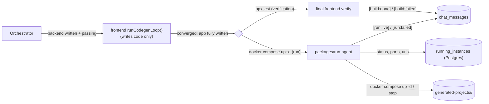

# Design: Run/Deploy Agent

- **Backlog item**: [`docs/backlog.md`](../backlog.md) — # 10
- **Status**: implemented — verified live against a real, previously-built
  generated project 2026-09-03 (not just unit tests)

## Outcome

Built as designed below, with one refinement made mid-build and two real
bugs found only by actually running it (unit tests, which mock Docker,
couldn't have caught either):

- **Refinement**: the docker-compose port placeholder ended up as
  `${RAILS_HOST_PORT}:3000` with no `:-` default (the sketch below
  originally had one). Confirmed live that `docker compose run --rm`
  (the Codegen Agent's own usage) doesn't publish a service's declared
  ports at all unless `--service-ports` is passed — so it never reads
  this env var regardless — and `docker compose up -d` (the Run Agent)
  always sets it before invoking. No default was needed.
- **Bug found live**: `docker compose up -d` returns once a container
  *starts*, not once the process inside is actually ready — the
  migration step raced MySQL's first-boot initialization and lost
  (`Can't connect to server on 'mysql' (115)`). Fixed with a real
  Compose healthcheck on `mysql` (`mysqladmin ping`) plus
  `depends_on: condition: service_healthy` on `rails`/`sidekiq`, so both
  `up -d` and `run --rm` now genuinely wait for MySQL, not just for its
  container to launch. Applied to `stack-spec/template/docker-compose.yml`.
- **Bug found live**: the generated backend's `Gemfile` never included a
  web server gem (`puma`) — unnoticed until now because verification only
  ever runs `bundle exec rspec`, never `rails server` for real. `rails
  server` failed immediately with "Could not find a server gem." Fixed by
  adding `gem "puma", "~> 6.4"` to `stack-spec/template/backend/Gemfile`
  and regenerating `Gemfile.lock` for real via Docker (not hand-edited).
- **Live verification**: ran the real `@app-builder/run-agent` package
  (compiled, not mocked) against an already-built generated project
  (`31f07053-1988-483a-953d-4676cefc3387` — a task tracker with backend +
  frontend both previously verified passing). `start()` discovered both
  components from its `docker-compose.yml`, allocated free ports
  dynamically, migrated the database, brought both up, and both
  responded `HTTP 200` to real host-side requests. `stop()` then
  `start()` again confirmed the fast-restart path works (fresh ports
  each time, no re-migration needed). Both fixes above were retroactively
  applied to that same generated project's own files to make this
  possible — the same "fix the template, then patch the live project the
  same way" pattern already established for bugs #3/#4.
- Backlog: bug #5 (react-dom/react-native-web), and two new bugs
  logged for the healthcheck race and the missing server gem, all marked
  `fixed` — see [`docs/backlog.md`](../backlog.md).

## Summary

Today, the only way to see a generated app running is to invoke
`docker compose` by hand (exactly what this session did manually via
`.claude/launch.json` to inspect a generated frontend). The Run Agent is a
new component that stands up the full generated stack as long-lived Docker
containers, wires backend + frontend together, and hands back a live
endpoint — with start/stop control and a persisted per-project record of
what's running.

Per explicit direction: **once the app is written and buildable, running
it and verifying it happen in parallel, not one after the other.** Today,
`/proceed` only lets you look at the result after every test has been
confirmed passing (or failing). Instead, as soon as the Codegen Agent has
finished *writing* the full app (backend already verified passing,
frontend code written), the Run Agent starts bringing the stack up live at
the same time as the frontend's final `npx jest` check runs — whichever
finishes first is posted to chat first. The live preview is explicitly
labeled as a preview, not a certified-passing build, if verification is
still in flight or later fails.

A project is also not always exactly "one backend + one frontend" — the
locked stack today happens to produce those two, but nothing in this
design should hardcode that shape. A project maps to an arbitrary number
of runnable components (whatever services its own `docker-compose.yml`
declares as exposable), each getting its own allocated port — a
one-to-many `project → components` relationship, not two fixed columns.

## Feature-set impact

- Once both codegen phases have produced a full app, the build flow no
  longer does "verify frontend, then (separately, manually) let the user
  run it." Instead it does both at once: a `[run] Starting your app...`
  message appears around the same time as continued `[build]` narration,
  and `[run:live]`/`[run:failed]` can arrive before, after, or interleaved
  with `[build:done]`/`[build:failed]` — they're independent outcomes now.
- `[run:live]` lists every exposed component the project actually has,
  not a fixed "API + App" pair, e.g. `[run:live] Your app is running —
  rails: http://localhost:34211, frontend: http://localhost:34212` for
  today's stack, but this scales to however many (or few) components a
  future stack variant declares.
- If verification later reports failures, the live preview isn't torn
  down — the user can still look at what's there; the failure message
  just isn't hidden or implied to be fixed.
- New commands, usable any time after a project has a written app (not
  only right after `/proceed`): **`/run`** (start it, or report the
  current URLs if it's already running) and **`/stop`** (stop the running
  containers, freeing the host ports; the project's code and Postgres
  data untouched — this is the same "never destroy the generated
  artifact" rule as manual verification already followed this session).
- Asking `/run` again while already running doesn't restart anything —
  it just reports the existing live URLs, so it's a safe way to ask "is
  it running?"

## Architecture impact



- **New component, `packages/run-agent`**: same standalone-library pattern
  as `intake-agent`/`codegen-agent`. Given a `workspacePath`, it
  *discovers* which of the project's docker-compose services should be
  exposed (not a hardcoded backend/frontend pair), allocates one free
  host port per discovered service, runs migrations, brings the full
  stack up with `docker compose up -d`, health-checks every discovered
  URL, and reports back a result per component. Also exposes
  `stop(workspacePath)`.
- **`packages/orchestrator`** gains `@app-builder/run-agent` as a
  dependency; the codegen-phase completion handler changes so that once
  the frontend's *code-writing* loop converges (not its verify step), it
  fires the frontend's final verification and the Run Agent's start
  concurrently instead of sequentially. New `/run` and `/stop` chat
  commands. New `runStore.ts` (Postgres), mirroring `projectStore.ts`/
  `chatStore.ts`.
- **`packages/codegen-agent`**: `runCodegenAgent()` currently bundles
  "run the loop" and "run final verification" into one awaited call, so
  there's no seam to interleave a concurrent step between them. The
  frontend call site needs to call `runCodegenLoop()` (already exported)
  and the verify step separately so the orchestrator can `Promise.all`
  the verify step against the Run Agent's start.
- **`stack-spec/template/docker-compose.yml`**: today, deliberately, *no*
  service publishes a host port (so two projects' stacks can coexist). A
  live, reachable instance needs published ports — parameterized via env
  vars the Run Agent sets per invocation (e.g.
  `${RAILS_HOST_PORT}:3000`, `${FRONTEND_HOST_PORT}:8081`), not fixed
  values, so concurrently-running projects still don't collide.
- **Hard prerequisite: [bug #5](../backlog.md)** (missing
  `react-dom`/`react-native-web`) must be fixed as part of this work, not
  separately — `expo start --web` is literally the frontend container's
  `CMD`, so the Run Agent's frontend leg cannot produce a working preview
  until that's fixed. Folding it into this feature's build step rather
  than tracking it as an independent backlog item to fix "someday."
- **New Postgres tables**: `running_instances` (one row per project —
  overall status) and `running_components` (one row per exposed
  component of that project — name, port, URL), a proper one-to-many
  mapping rather than fixed columns for a fixed pair of services. Unlike
  the in-memory `buildingProjects`/`pendingSpecs` sets, these survive an
  orchestrator restart — though the Docker containers themselves are the
  source of truth for whether something is *actually* still running; the
  tables can go stale if containers are stopped outside the app (flagged
  under Out of scope).

## Components affected

- `packages/run-agent` (new) — port allocation, `docker compose up -d`
  sequencing (deps → migrate → app services), health checks, `stop()`.
- [`packages/orchestrator`](../../packages/orchestrator) — `app.ts` (`/run`,
  `/stop` handlers; codegen-phase completion restructured for the
  parallel verify+run trigger), new `runStore.ts`. See
  [component blueprint](../blueprints/components/orchestrator.md).
- [`packages/codegen-agent`](../../packages/codegen-agent) — `agent.ts`:
  no behavior change to `runCodegenAgent()` itself, but its loop+verify
  steps need to be callable separately from the frontend call site. See
  [component blueprint](../blueprints/components/codegen-agent.md).
- [`stack-spec/template/docker-compose.yml`](../../stack-spec/template/docker-compose.yml)
  — parameterized host ports for `rails` and `frontend`; update the
  comment explaining why (currently says host ports are never published).
- [`stack-spec/template/frontend/`](../../stack-spec/template/frontend) —
  fix bug #5 (`react-dom`/`react-native-web`).
- [`packages/web`](../../packages/web) — render `[run]`/`[run:live]`/
  `[run:failed]` messages (same polling mechanism, extended terminal-tag
  regex); a "Stop" affordance is a nice-to-have, not required for v1
  (`/stop` typed in chat works either way).

## Design

### Trigger point: "written and buildable," not "verified"

Today's `defaultRunCodegenPhase` (`packages/orchestrator/src/app.ts`):

```
backendResult = await runCodegenAgent(backend...)   // loop + verify, sequential
if (!backendResult.testsPassed) return failed
frontendResult = await runCodegenAgent(frontend...) // loop + verify, sequential
return frontendResult.testsPassed ? done : failed
```

New shape — the frontend phase splits its loop from its verify step so a
third concurrent step (the Run Agent) can start at the same instant as
verification, once code-writing is done:

```
backendResult = await runCodegenAgent(backend...)
if (!backendResult.testsPassed) return failed

onProgress("Backend complete — " + backendResult.verifySummary + ". Starting the frontend...")
loopResult = await runCodegenLoop(frontend...)      // writes code only, no verify yet

onProgress("Frontend written — verifying and starting your app...")
const [verifyResult, runResult] = await Promise.allSettled([
  verifyFrontend(loopResult, frontendDocker),        // "npx jest" — same as runCodegenAgent's internal step, extracted
  runAgent.start({ workspacePath, projectId }),
])

// verifyResult drives [build:done]/[build:failed], same as today
// runResult drives [run:live]/[run:failed], posted independently
```

Both promises post their own chat message as soon as *they* resolve —
they are not joined into one combined message, so whichever finishes
first is what the user sees first. Backend must already be verified
passing before this point; the parallelization is scoped to
frontend-verify vs. run, not backend vs. anything.

### Discovering exposable components

`docker-compose.yml` stays the single source of truth for what a
project's stack looks like — no separate manifest file to keep in sync.
Convention: any service whose `ports:` entry uses a
`${<NAME>_HOST_PORT}`-shaped placeholder (case-insensitive match on the
service name) is a component the Run Agent should expose; anything else
(`mysql`, `mongo`, `redis`, `sidekiq` today — internal-only, no `ports:`
placeholder) is left alone. This is a parse of the compose YAML's
`services` map and each service's `ports` list — no build-spec parsing
involved, and it scales to however many components a future stack variant
declares without a code change to the Run Agent itself.

### `packages/run-agent` — `start()` sequence

```ts
export interface ComponentResult {
  name: string;       // docker-compose service name, e.g. "rails", "frontend"
  port: number;
  url: string;
}

export interface StartResult {
  status: "live" | "failed";
  components: ComponentResult[];  // empty on failure
  error?: string;
}

export async function start(params: { workspacePath: string; projectId: string }): Promise<StartResult>
export async function stop(params: { workspacePath: string; projectId: string }): Promise<void>
```

`start()`:

1. Parse `docker-compose.yml`, discover exposable components (above), and
   allocate one free host port per component (bind to port 0, read back
   the OS-assigned port, close — standard "find a free port" trick).
2. `docker compose up -d` for every service that has no `ports:`
   placeholder (the internal dependency services) — brings them up first,
   in `depends_on` order, same as Compose already does.
3. If a `rails`-named service is among the discovered components: `docker
   compose run --rm rails bin/rails db:create db:migrate` — ensure the
   schema exists before `rails server` starts serving. (Migrations are a
   Rails-specific step, not a generic one — the locked stack's data layer
   isn't itself pluggable, only the *set* of components is.)
4. `docker compose up -d` for the discovered components, with each one's
   `<NAME>_HOST_PORT` env var set to its allocated port.
5. Health-check: poll every discovered component's URL (plain HTTP GET,
   short timeout, a handful of retries) until all respond or a total
   timeout elapses.
6. On success: upsert `running_instances` (`status: "live"`) and one
   `running_components` row per component; return
   `{ status: "live", components }`.
7. On failure at any step: upsert `running_instances`
   (`status: "failed"`, `last_error`) and return
   `{ status: "failed", components: [], error }`.

`stop()`: `docker compose stop` with no service arguments — stops every
service in the project's stack (not `down`: named volumes, the network,
and data all survive a `stop`, so a follow-up `/run` is fast and doesn't
re-run migrations against an empty database). No service names to
enumerate here either, consistent with the discovery-based design above.
Upsert `running_instances` to `status: "stopped"`.

### Orchestrator: `/run` and `/stop`

```
/run:
  existing = runStore.get(projectId)   // { instance, components[] }
  if existing?.instance.status === "live":
    reply "[run:live] Already running — " + existing.components.map(c => `${c.name}: ${c.url}`).join(", ")  (no-op)
  if existing?.instance.status === "starting": reply "[run] Still starting — please wait." (no-op)
  else:
    ack "[run] Starting your app..."
    fire-and-forget runAgent.start(...) -> post [run:live]/[run:failed] listing every component, update runStore

/stop:
  existing = runStore.get(projectId)
  if !existing or existing.instance.status !== "live": reply "Nothing is running for this project."
  else:
    await runAgent.stop(...)
    reply "[stop:done] Stopped — your data and code are untouched."
```

Both guarded the same way `/build`/`/proceed` are guarded against
concurrent runs — reuse the existing `buildingProjects`-style per-project
`Set` pattern for a new `runningOps` set (start/stop in flight), so a
`/run` and a `/stop` can't race each other for the same project.

### `docker-compose.yml` port parameterization

```yaml
rails:
  ports:
    - "${RAILS_HOST_PORT}:3000"
  depends_on:
    mysql:
      condition: service_healthy
frontend:
  ports:
    - "${FRONTEND_HOST_PORT}:8081"
mysql:
  healthcheck:
    test: ["CMD", "mysqladmin", "ping", "-h", "localhost"]
    interval: 3s
    timeout: 3s
    retries: 20
```

No default needed for the port env vars: `docker compose run --rm` (the
Codegen Agent's own usage) doesn't publish a service's declared ports at
all unless `--service-ports` is passed, so it's unaffected whether or not
the var is set — only `docker compose up -d` (the Run Agent) ever reads
it, and the Run Agent always sets it first. The `mysql` healthcheck is a
real fix, not a hypothetical: `up -d` returning as soon as a container
*starts* (not once MySQL is actually ready to accept connections) caused
a real migration failure during live verification — see Outcome above.

### `running_instances` / `running_components` tables

```sql
CREATE TABLE running_instances (
  project_id TEXT PRIMARY KEY REFERENCES projects(id),
  status TEXT NOT NULL,             -- starting | live | stopping | stopped | failed
  last_error TEXT,
  started_at TIMESTAMPTZ,
  updated_at TIMESTAMPTZ NOT NULL DEFAULT now()
);

CREATE TABLE running_components (
  project_id TEXT NOT NULL REFERENCES running_instances(project_id) ON DELETE CASCADE,
  name TEXT NOT NULL,               -- docker-compose service name, e.g. "rails", "frontend"
  port INTEGER NOT NULL,
  url TEXT NOT NULL,
  PRIMARY KEY (project_id, name)
);
```

One `running_instances` row per project (this design still assumes a
single running instance of a given project, not multiple concurrent
instances of the *same* project) and one `running_components` row per
exposed component of that instance — the one-to-many mapping.

## Out of scope

- HTTPS, a reverse proxy, or stable per-project domains — `localhost:PORT`
  only, same as this session's manual inspection.
- Multiple simultaneous instances of the same project.
- Auto-stopping idle instances to free resources — a fast-follow, not v1.
- Reconciling `running_instances` against reality if containers are
  stopped or removed outside the app (e.g. `docker compose down` run by
  hand, or the host rebooting) — the table can go stale; `/run`'s
  "already live" no-op is a known soft spot until a reconciliation pass
  exists.
- Delivery (git push/zip) — unrelated, still not built.
- Surviving an orchestrator restart mid-`start()`/`stop()` — the
  in-flight guard (`runningOps` set) resets like `buildingProjects` does
  today; the persisted `running_instances` row is more durable than that
  guard, but a restart mid-operation can still leave it in a `starting`/
  `stopping` limbo state requiring a manual `/run`/`/stop` retry.
