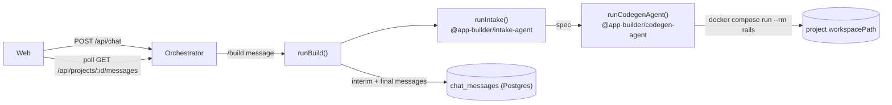

# Design: Wire the Intake + Codegen Agents into Orchestrator Chat

- **Backlog item**: [`docs/backlog.md`](../backlog.md) — # 7 (Phase 3, milestone 1)
- **Status**: implemented — verified end-to-end through the real browser UI 2026-09-02

## Outcome

Verified through the actual web UI, not just curl/unit tests: created a
project (`BuildWiringTest2`), sent
`/build a simple task tracker where each task has a title and a done flag`,
and watched it work exactly as designed —

- Immediate ack (`[build] Got it — analyzing your description...`),
  rendered in the browser via the very first `POST /api/chat` response.
- The web UI's polling picked up 8 further interim messages as the
  Codegen Agent worked — including it narrating real self-corrections:
  a missing FactoryBot mixin, a controller namespace mismatch, a typo it
  introduced and caught, and three real test failures (Blueprinter's
  `root` requirement, `record.errors.full_messages` vs `record
  .full_messages`, and Rails' JSON param-wrapping behavior).
- Final message: `[build:done] Build complete — 19 examples, 0 failures`.
  Polling stopped immediately after — confirmed no further
  `/messages` requests fired in the 15+ seconds afterward.
- The concurrency guard, empty-description guard, and ordinary
  (non-`/build`) chat were all exercised in the same session: a follow-up
  "how does /build work?" got a normal passthrough reply (using the
  updated system prompt, correctly referencing the just-finished build
  from real conversation history) with no build triggered.

No design changes were needed — the plan as agreed matched what actually
happened, including the message-tagging convention and the polling
stop-condition working correctly on the first real run.

## Summary

Today, chat is a direct GLM passthrough — the Intake and Codegen Agents
exist but are standalone, developer-run CLIs with no orchestrator
involvement (this is literally what [bug #1](../backlog.md) surfaced: chat
correctly says it can't build anything). This wires them in for the
first time: a chat message starting with `/build <description>` runs the
Intake Agent, then — if it produces a spec rather than a clarifying
question — the Codegen Agent, against that project's own scaffolded
`workspacePath`. Progress is posted back into chat as it happens (reusing
the Codegen Agent's own narration, not a synthetic tracker), and the web
UI polls for updates while a build is running so it doesn't look stuck.

Deliberately excluded from this milestone: accounts, real streaming
(SSE/WebSocket), delivery (git push/zip), and durable job persistence
across an orchestrator restart. This is the smallest slice that makes
`/build` genuinely work end-to-end through the UI, matching how every
prior milestone in this project started narrow before adding scope.

## Feature-set impact

- New: sending `/build <description>` in chat for a project triggers a
  real build against that project's own workspace instead of a generic
  chat reply.
- If the description is ambiguous, the assistant's reply is the Intake
  Agent's clarifying question — the user just sends another `/build`
  with more detail, same one-shot behavior as the CLI.
- If a build starts, the assistant immediately acknowledges, then posts
  further short progress messages as the Codegen Agent works (its own
  narration, e.g. "Shapes confirmed. Now updating controllers..."), and
  finally a pass/fail result with the `bundle exec rspec` summary. The
  web UI keeps refreshing the chat log while a build is in flight so this
  actually appears without a manual reload.
- Only one build runs per project at a time — a second `/build` while one
  is in flight gets a "please wait" reply instead of starting a
  conflicting second run against the same workspace.
- Ordinary chat (anything not starting with `/build`) is unchanged. The
  system prompt's "not available yet" line is updated to point at
  `/build` instead of just saying no.

## Architecture impact



- **`packages/orchestrator`** gains `@app-builder/intake-agent` and
  `@app-builder/codegen-agent` as real dependencies — their first actual
  consumer. Calls `runIntake`/`runCodegenAgent` directly as libraries, in
  the same Node process — no shelling out to their CLIs, no build-spec
  file on disk (the Intake Agent's markdown output is passed to the
  Codegen Agent in memory).
- **`packages/codegen-agent`** gets a small refactor: the setup → loop →
  final `bundle exec rspec` verification sequence currently inlined in
  `cli.ts` is extracted into a new `runCodegenAgent()` function (in
  `agent.ts`), so both the CLI and the orchestrator call the same tested
  code instead of duplicating it. `cli.ts` becomes a thin wrapper around
  it (parse argv, call it, print results, `down()` in `finally` — teardown
  stays the caller's job, unchanged).
- No new persistence: chat messages already live in Postgres
  (`chat_messages`); interim/result messages are just more rows, tagged
  by content prefix (`[build]`, `[build:question]`, `[build:done]`,
  `[build:failed]`) rather than a new DB column — consistent with this
  project's preference for plain text over new structure where a schema
  change isn't buying real safety (see the Intake Agent's own markdown
  design).
- **Known, deliberate limitation**: the "background" build is an
  un-awaited in-process promise, guarded by an in-memory
  `Set<projectId>` against a second concurrent build for the *same*
  project. If the orchestrator restarts mid-build, that result is lost
  and the guard resets — no job queue/durability yet. Real streaming
  (SSE/WebSocket) is still deferred; the web UI's HTTP polling is a cheap
  stand-in scoped to this milestone only.

## Components affected

- [`packages/orchestrator`](../../packages/orchestrator) — `app.ts` (the
  `/build` branch, the concurrency guard, the updated `SYSTEM_PROMPT`),
  `package.json` (two new dependencies). See
  [component blueprint](../blueprints/components/orchestrator.md).
- [`packages/codegen-agent`](../../packages/codegen-agent) — `agent.ts`
  (new `runCodegenAgent()`), `cli.ts` (simplified to use it). See
  [component blueprint](../blueprints/components/codegen-agent.md).
- [`packages/web`](../../packages/web) — `App.tsx` (detect `/build`
  submissions, poll while a build is in flight, stop on a terminal
  message). See [component blueprint](../blueprints/components/web.md).

## Design

### Message tagging convention (no new DB column)

Every message the build flow posts is a normal `role: "assistant"` chat
message (so it's part of conversation history like anything else),
distinguished only by a content prefix:

- `[build] <text>` — interim/informational, non-terminal (the initial
  ack, "starting Codegen Agent," and the Codegen Agent's own narration
  lines).
- `[build:question] <text>` — terminal: the Intake Agent needs more
  information; no Codegen Agent run happened.
- `[build:done] <text>` — terminal: the Codegen Agent finished and
  `bundle exec rspec` passed.
- `[build:failed] <text>` — terminal: the Codegen Agent finished but
  tests didn't pass, hit its iteration cap, or something threw (Docker,
  LLM, or agent error) — all collapsed into one terminal state for this
  milestone; not distinguishing *why* it failed beyond the message text.

The client's only use of this convention is one regex,
`/^\[build:(done|failed|question)\]/`, to know when to stop polling —
deliberately the same "plain text over parser" choice as the Intake
Agent's own `QUESTION:` marker.

### Orchestrator: `runBuild()` — the injectable seam

Mirrors the existing `Scaffold` injection pattern in `app.ts`
(`createApp(..., scaffold: Scaffold = defaultScaffold)`) so `/build` is
unit-testable without real Docker/GLM:

```ts
export type RunBuild = (params: {
  workspacePath: string;
  description: string;
  llmClient: LLMClient;
  onProgress: (content: string) => void;
}) => Promise<
  | { kind: "question"; content: string }
  | { kind: "done"; content: string }
  | { kind: "failed"; content: string }
>;
```

Default implementation:

1. `runIntake({ llmClient, systemPrompt: intakeAgent.buildSystemPrompt(), description })`.
2. If `kind === "question"` → return `{ kind: "question", content }` immediately — no Codegen Agent run.
3. Otherwise, call `onProgress("Spec ready — starting the Codegen Agent. This can take several minutes.")`, then build `fileTools`/`dockerRunner` for `workspacePath/backend`, and call
   `codegenAgent.runCodegenAgent({ llmClient, systemPrompt: await codegenAgent.buildSystemPrompt(), buildSpec: intakeResult.content, fileTools, dockerRunner, onEvent })`,
   where `onEvent` calls `onProgress(event.content)` for every `assistant_message` event with non-empty content.
4. On success (`testsPassed`) → `{ kind: "done", content: "Build complete — " + rspecSummary }`; otherwise → `{ kind: "failed", content: "Build finished but tests did not pass after N iteration(s): " + rspecSummary }`.
5. Any thrown error → `{ kind: "failed", content: "Build failed: " + error.message }`.
6. `dockerRunner.down()` in a `finally`, same as the CLI.

### Orchestrator: `/api/chat` branch

```
if message starts with "/build":
  if buildingProjects.has(projectId): reply "[build] A build is already running for this project — please wait for it to finish." (no run started)
  description = message text after "/build", trimmed
  if description is empty: reply "[build] Please describe what to build after /build, e.g. `/build a task tracker with a title and due date`." (no run started)
  else:
    append [userMessage, ackMessage="[build] Got it — analyzing your description..."]
    respond immediately with { reply: ackMessage.content, finishReason: "stop" }
    buildingProjects.add(projectId)
    runBuild({ workspacePath: project.workspacePath, description, llmClient,
               onProgress: (text) => chatStore.append(projectId, [{ role: "assistant", content: `[build] ${text}` }]) })
      .then(outcome => chatStore.append(projectId, [{ role: "assistant", content: `[build:${outcome.kind}] ${outcome.content}` }]))
      .catch(error => chatStore.append(projectId, [{ role: "assistant", content: `[build:failed] Unexpected error: ${error.message}` }]))
      .finally(() => buildingProjects.delete(projectId))
    # not awaited — request already responded
else:
  ... existing passthrough logic, unchanged ...
```

`buildingProjects` is a plain `Set<string>` in `createApp`'s closure —
per-process, matches the "no durability yet" limitation above.

### `packages/codegen-agent`: extracting `runCodegenAgent()`

```ts
export interface RunCodegenAgentResult {
  converged: boolean;
  iterations: number;
  testsPassed: boolean;
  rspecSummary: string; // e.g. "31 examples, 0 failures", parsed from stdout
  rspecOutput: string;
}

export async function runCodegenAgent(options: RunOptions): Promise<RunCodegenAgentResult> {
  const loopResult = await runCodegenLoop(options);
  const verification = await options.dockerRunner.run("bundle exec rspec");
  const summaryMatch = verification.stdout.match(/^\d+ examples?, \d+ failures?.*$/m);
  return {
    converged: loopResult.converged,
    iterations: loopResult.iterations,
    testsPassed: verification.exitCode === 0,
    rspecSummary: summaryMatch?.[0] ?? `rspec exited ${verification.exitCode}`,
    rspecOutput: verification.stdout,
  };
}
```

`cli.ts` is rewritten to call this instead of inlining the loop + final
`bundle exec rspec` call itself — same behavior, less duplication. `down()`
stays the caller's responsibility in both the CLI and the orchestrator
(not inside `runCodegenAgent`), matching the existing separation between
"run the loop and verify" and "tear down the sandbox."

### `packages/web`: detecting `/build` and polling

- `handleSubmit`: if the submitted message starts with `/build`, after
  the (fast) ack response comes back, mark that project as "building"
  (`Record<projectId, boolean>` state) in addition to the existing
  `appendMessage` call — no other change to the submit path.
- A `useEffect` polls `GET /api/projects/:id/messages` every ~4s **only**
  while the *currently selected* project is marked "building." Each poll
  compares the fetched list's length to the locally-held message count
  and appends only the new tail entries (same shape/order the server
  already guarantees) — no diffing by id needed since both sides append
  in the same order.
- If any newly-appended message's content matches
  `/^\[build:(done|failed|question)\]/`, clear that project's "building"
  flag (stopping the poll) after appending it.
- **Known limitation**: polling only runs for the currently selected
  project. Switching away and back mid-build won't resume live updates
  until the next full page reload (the existing "load history once per
  project" effect doesn't re-fetch). Acceptable for this milestone; real
  streaming would remove this limitation properly, later.

### System prompt update (closes bug #1's underlying gap)

`SYSTEM_PROMPT` in `app.ts` changes from "app generation isn't available
in this chat yet" to something like: *"If asked to build/create/generate
an app, tell them to send a message starting with `/build` followed by a
description, e.g. `/build a task tracker with a title and due date`."*

## Verification plan

Same discipline as every prior milestone — real, not just unit-tested:

1. Unit tests for the `/build` branch with a fake `RunBuild` (ack +
   interim + terminal messages land correctly; the concurrency guard
   rejects a second `/build`; an empty description is rejected without
   invoking `runBuild`; ordinary chat is unaffected) — no real Docker/GLM.
2. Unit tests for `runCodegenAgent()` (fake loop/docker runner — pass and
   fail cases, `rspecSummary` parsing).
3. **Real end-to-end run through the actual web UI**: start the dev
   servers, create a project, type `/build <description>` in the browser,
   and watch interim messages arrive via polling and a final
   `[build:done]`/`[build:failed]` message — not just curl/CLI-level
   verification, since the polling/UI wiring is exactly what unit tests
   can't cover.

## Out of scope (this milestone)

- Accounts, real streaming (SSE/WebSocket), delivery (git push/zip) —
  later Phase 3 work per the roadmap.
- Durable job queue — a restart mid-build loses that build; acceptable
  for now, flagged above.
- Multi-turn conversation for a `[build:question]` — the user sends a
  brand new `/build <fuller description>`, same one-shot behavior as the
  standalone Intake Agent CLI.
- Polling for a project that isn't currently selected.
