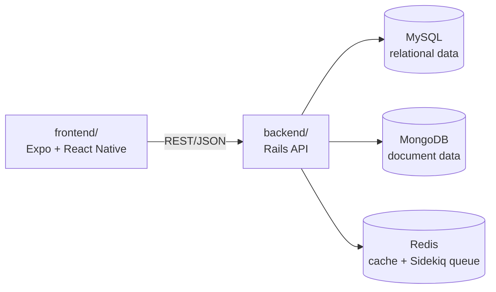

# Architecture Blueprint

High-level shape of this app. Per-component detail lives under
[`components/`](./components/); current capabilities are inventoried in
[`features.md`](./features.md).

## Current implementation (scaffold only)

- **`backend/`** — Rails API skeleton. → [blueprint](./components/backend.md)
- **`frontend/`** — Expo/React Native skeleton. → [blueprint](./components/frontend.md)
- **`docker-compose.yml`** — wires rails + mysql + mongo + redis + sidekiq
  for local development.

Nothing here is installed or runnable yet — this is the structural
skeleton copied from the app-builder's `stack-spec/template/`. Making it
a real, working app is the first feature this project needs.

## Locked stack

Backend: Rails + MySQL + MongoDB + Redis/Sidekiq, Devise+JWT, Blueprinter,
RSpec. Frontend: Expo/React Native + React Navigation + Zustand + React
Native Paper, Jest. These are locked — do not substitute a different
library/version without discussing it first (see the mandatory workflow
in [`../../CLAUDE.md`](../../CLAUDE.md)).

For what's next, see [`../backlog.md`](../backlog.md); for what shipped
when, see [`../../CHANGELOG.md`](../../CHANGELOG.md).
